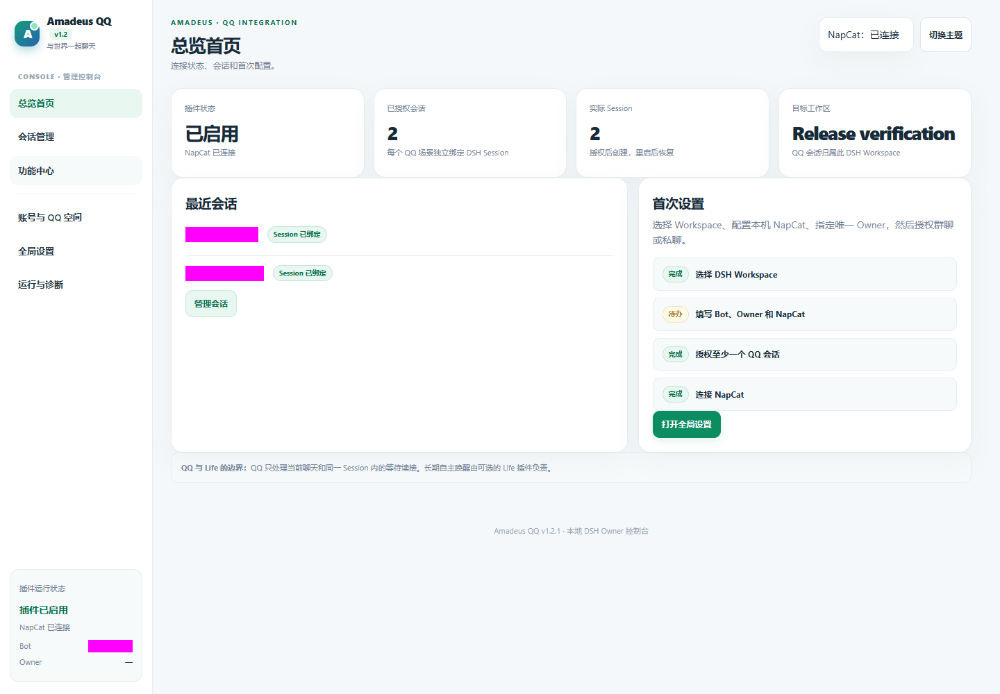

# Amadeus Qq

[English](README.md) · [详细配置参考](REFERENCE.md)

通过持久 DSH 会话与明确的场景权限连接 QQ。

目标发行包：**`@fg-lab/amadeus-qq@1.2.1`**。已验证的官方 DSH Desktop 基线：**0.2.1-rc.3**。许可证：MIT。

## 当前发行状态

目前是产品化候选。正式 npm 与 GitHub Release 发布仍需通过发布门禁并完成 npm 账户授权；这里的版本号不代表已经公开发行。

## 安装与首次配置

使用官方 DSH 插件管理器将预构建 `.tgz` 安装到所需 Profile，无需手工构建源码。按[安装说明](docs/INSTALL_V1_2.md)操作，不要手工改写正在运行的 Profile。

配置 NapCat、选择工作区、填写管理员 QQ 号并逐项授权场景。建议先选择仅观察。

其他 Amadeus 插件均为可选联动，按需要分别安装。

## 界面

截图展示已有界面，不表示本轮所有真实平台能力均已通过。具体限制请阅读配置参考和验收报告。

## 升级与回滚

升级前备份用户数据。程序、持久数据和恢复备份分开保存。禁用停止功能；卸载默认保留外部数据。回退旧程序不能自动撤销数据库迁移。

- [升级政策](docs/UPGRADE_POLICY.md)
- [数据迁移与恢复](docs/DATA_MIGRATION.md)
- [发行检查清单](docs/RELEASE_CHECKLIST.md)
- [完整配置与限制](REFERENCE.md)

[项目主页](https://github.com/jeskoky-pixel/Amadeus-dsh) · [MIT 许可证](LICENSE)
